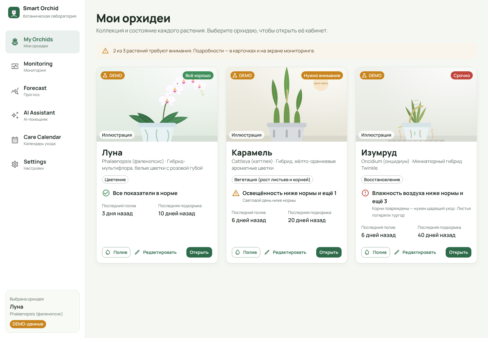
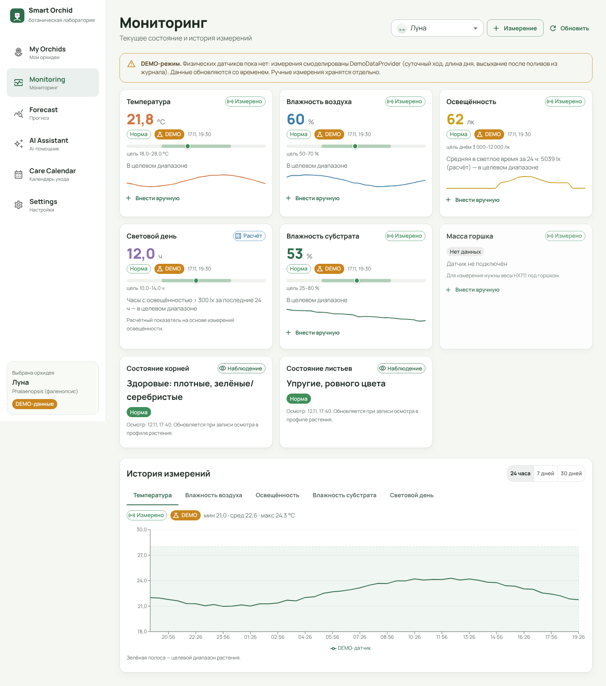
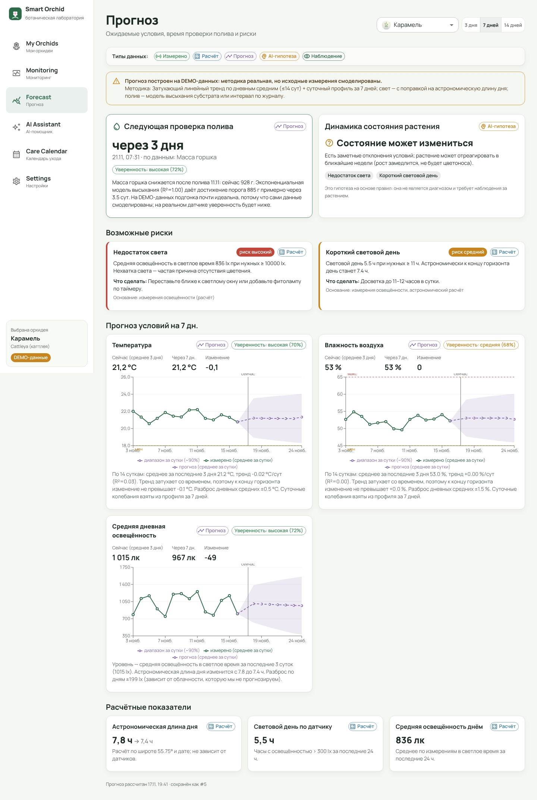
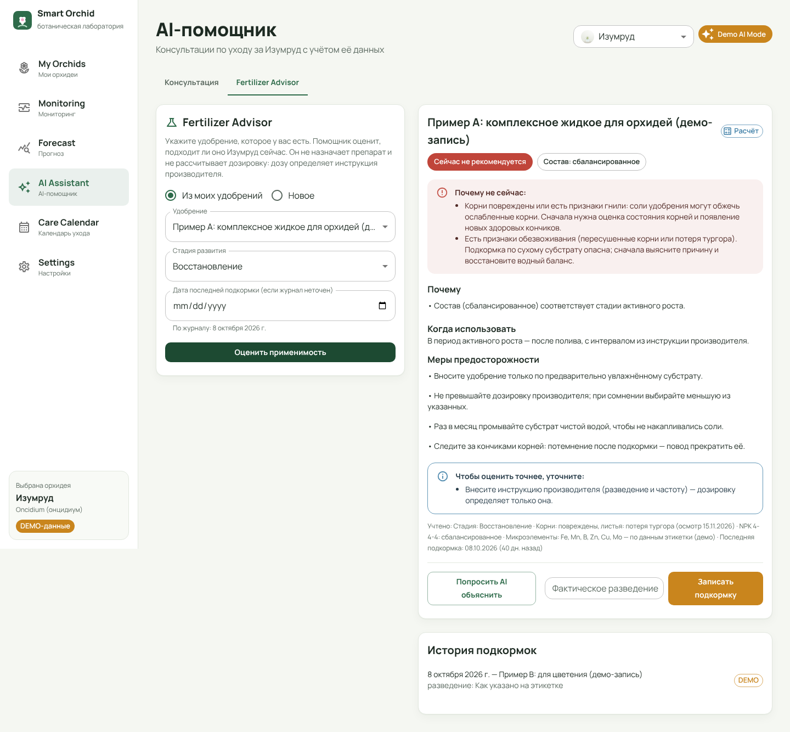

# 🌸 Smart Orchid — умная орхидея

Full Stack MVP для мониторинга, прогнозирования и ухода за комнатными орхидеями. Задел на IoT-систему «умного сада».

| My Orchids | Monitoring |
|---|---|
|  |  |
| **Forecast** | **Fertilizer Advisor** |
|  |  |

## Быстрый старт

Нужны **Python 3.11+** (рекомендуется 3.12) и Node.js 18+.

> ⚠️ На macOS системный `python3` — это часто Python 3.9, и с ним бэкенд не запустится
> (`TypeError: unsupported operand type(s) for |`). Проверьте версию: `python3 --version`.
> Установка: macOS — `brew install python@3.12`, Windows — установщик с python.org, Ubuntu — `sudo apt install python3.12 python3.12-venv`.
> Затем создавайте окружение командой `python3.12 -m venv .venv`.

**Backend** (терминал 1):

```bash
cd backend
python3.12 -m venv .venv && source .venv/bin/activate
pip install -r requirements.txt
cp .env.example .env          # по желанию: ANTHROPIC_API_KEY для режима Claude
uvicorn app.main:app --reload --port 8000
```

**Frontend** (терминал 2):

```bash
cd frontend
npm install
npm run dev
```

| Что | Адрес |
|---|---|
| Приложение | http://localhost:5173 |
| Swagger UI | http://localhost:8000/docs |
| OpenAPI JSON | http://localhost:8000/openapi.json |

При первом запуске backend создаёт SQLite-базу `backend/smart_orchid.db`, три демонстрационные орхидеи и 30 дней DEMO-измерений.
Сбросить демо-данные можно в **Settings → Пересоздать DEMO** или удалив файл базы.

**Тесты backend:**

```bash
cd backend && source .venv/bin/activate && pytest -q
```

## Три демонстрационные орхидеи

| | Вид | Стадия | Датчики (DEMO) | Состояние |
|---|---|---|---|---|
| **Луна** | Phalaenopsis | Цветение | SHT31, BH1750, датчик влажности субстрата | Всё в норме, фитолампа 12 ч |
| **Карамель** | Cattleya | Вегетация | DHT22, BH1750, весы HX711 | Мало света и короткий день → не цветёт |
| **Изумруд** | Oncidium | Восстановление | только DHT22 | Повреждены корни, сухой воздух у радиатора → «Срочно» |

У Изумруда нарочно нет датчиков света и субстрата: так видно, что система не придумывает отсутствующие измерения.

## Архитектура

```
frontend (React + TS + MUI)  ──REST /api──►  backend (FastAPI)
                                              ├─ api/          роуты, валидация, коды ошибок
                                              ├─ services/     бизнес-логика
                                              │   ├─ monitoring.py   текущее состояние, история, статусы
                                              │   ├─ forecast.py     прогноз 3/7/14 дн., полив, риски
                                              │   ├─ fertilizer.py   Fertilizer Advisor (правила)
                                              │   ├─ care.py         журнал и план ухода
                                              │   └─ ai/             контекст, Demo-движок, Claude-движок
                                              ├─ providers/    источники данных (DataProvider)
                                              │   ├─ demo.py   DemoDataProvider
                                              │   └─ iot.py    IoTDataProvider
                                              ├─ models.py     SQLAlchemy
                                              └─ schemas.py    Pydantic
                                                      │
                                                SQLite (MVP) / PostgreSQL
```

Сервисы получают данные только через интерфейс `DataProvider` (`sync`, `latest`, `series`, `available_metrics`).
Мониторинг и прогноз одинаково работают с `DemoDataProvider` и `IoTDataProvider`; источник растения переключается в Settings.

### Четыре типа данных — никогда не смешиваются

| Тип | Пример | Метка в UI |
|---|---|---|
| Измерено | температура с датчика, ручное измерение | `Измерено` + источник `DEMO` / `IoT` / `Вручную` |
| Расчёт | световой день, средняя дневная освещённость, длина дня | `Расчёт` |
| Прогноз | температура через 7 дней, время проверки полива | `Прогноз` + уверенность |
| Гипотеза | динамика состояния, «обезвоживание» | `AI-гипотеза` |
| Наблюдение | состояние корней и листьев после осмотра | `Наблюдение` |

DEMO-, IoT- и ручные измерения хранятся с разным `source`: графики показывают их разными сериями, а в текущем значении ручной ввод отображается отдельно.

### DemoDataProvider

Демо-данные — это не случайные числа, а детерминированная модель: суточный ход температуры, влажность в противофазе к ней,
освещённость по астрономической длине дня (55.75° с. ш.) с облачностью и фитолампой, экспоненциальное высыхание субстрата
после **поливов из журнала** (записали полив — влажность в DEMO-ряду растёт), масса горшка по влажности.
Воспроизводимый шум (CRC32), шаг 30 минут. При каждом запросе ряд досинхронизируется до текущего момента.

### Прогноз

* Дневные средние за ≤14 суток → линейный тренд (МНК) с затуханием (φ = 0,85/сут) + суточный профиль за 7 дней.
* Интервал ±1,64σ остатков, расширяется с горизонтом.
* Свет — с поправкой на изменение астрономической длины дня.
* Полив: экспоненциальная модель высыхания по датчику субстрата или весам; без них — медианный интервал по журналу,
  скорректированный на прогноз климата (уверенность низкая, и это честно указано).
* Уверенность = достаточность данных × качество подгонки × горизонт; в каждом прогнозе есть текстовое объяснение.
* Риски (перегрев, сухой воздух, недостаток света, гниль корней, обезвоживание…) — по прозрачным правилам, с основанием.

### AI-помощник

* **Demo AI Mode** (по умолчанию, без ключа): экспертные правила по 7 темам; ответ ссылается на конкретные измерения с датой и
  источником, задаёт уточняющие вопросы и перечисляет отсутствующие данные.
* **Claude**: задайте `ANTHROPIC_API_KEY` в `backend/.env`. Ключ хранится только на сервере, в браузер не передаётся.
  Модель `claude-opus-5-5` (меняется через `CLAUDE_MODEL`), включён серверный fallback на случай отказа модели.
  При любой ошибке API ответ автоматически строится в Demo-режиме, и пользователь видит предупреждение.
* Claude получает JSON-контекст растения: вид, стадию, измерения, наблюдения, поливы, подкормки, прогноз, сезон и список отсутствующих данных.
* **Fertilizer Advisor** оценивает только удобрение, указанное пользователем (NPK, микроэлементы, инструкция).
  Он не назначает препарат, не придумывает составы и дозировки, а при повреждённых корнях или обезвоживании блокирует рекомендацию.
  Запись подкормки делается только явной кнопкой.

## Модель данных

| Сущность | Ключевые поля | Связи |
|---|---|---|
| `Plant` | name, species, variety, photo_url, stage, root/leaf_status, observed_at, целевые диапазоны, интервалы ухода, data_source | 1–N к остальным |
| `Sensor` | sensor_type (DHT22/SHT31/BH1750/HX711/…), metrics[], source, hardware_id (unique), is_active | Plant |
| `SensorReading` | sensor_id, plant_id, metric, value, unit, timestamp, source, quality | Plant, Sensor; индекс (plant, metric, source, ts) |
| `CareEvent` | event_type, timestamp, amount_ml, method, notes, source | Plant |
| `Fertilizer` | name, manufacturer, npk_n/p/k, micronutrients, concentration, labeled_for_orchids, manufacturer_instructions | — |
| `FertilizerApplication` | fertilizer_id, care_event_id, applied_at, dilution, stage_at_application | Plant, Fertilizer, CareEvent |
| `Forecast` | horizon_days, method, data_source, payload (JSON-снимок) | Plant |
| `AIConsultation` | topic, question, answer, mode, model, context_snapshot | Plant |

Валидация: физические диапазоны и единицы измерений, запрет дат в будущем, min ≤ max для целевых диапазонов,
`extra="forbid"` на входных схемах. Ошибки возвращаются как `{"detail", "code", "errors": [{field, message}]}`.

## REST API

| Метод | Путь | Назначение |
|---|---|---|
| GET | `/api/plants` | карточки коллекции |
| GET / PUT | `/api/plants/{id}` | профиль / редактирование |
| POST | `/api/plants/{id}/photo` | загрузка фото (JPEG/PNG/WebP ≤ 5 МБ) |
| GET | `/api/plants/{id}/monitoring` | текущее состояние |
| GET | `/api/plants/{id}/history?period=24h\|7d\|30d` | история измерений |
| GET | `/api/plants/{id}/forecast?horizon=3\|7\|14` | прогноз |
| GET / POST | `/api/plants/{id}/care` | журнал и план ухода / новое событие |
| GET / POST | `/api/plants/{id}/fertilizers` | удобрения и подкормки / Fertilizer Advisor |
| GET | `/api/plants/{id}/consultations`, `/sensors` | история AI, датчики |
| POST | `/api/ai/consult` | консультация AI |
| GET / POST | `/api/sensors` | список / регистрация IoT-датчика |
| POST | `/api/sensors/readings` | измерения: одно или пакет (`manual` / `iot`) |
| GET | `/api/dashboard/summary` | сводка по коллекции |
| GET / POST | `/api/system/status`, `/api/system/reset-demo` | конфигурация, сброс демо |

## Подготовка к IoT (ESP32)

1. Зарегистрировать датчик: `POST /api/sensors` с `{"plant_id": 1, "sensor_type": "SHT31", "name": "...", "hardware_id": "esp32-<mac>-sht31"}`.
2. Переключить растение на источник IoT (Settings).
3. ESP32 отправляет пакет:
   ```json
   {"readings": [{"plant_id": 1, "metric": "temperature", "value": 22.8, "source": "iot", "hardware_id": "esp32-<mac>-sht31"}]}
   ```
Backend проверяет, что датчик существует, привязан к этому растению и измеряет данную метрику, а также проверяет единицы и диапазон.
Следующий шаг — аутентификация устройств (токен на датчик) и прошивка ESP32 (DHT22/SHT31, BH1750, HX711).

## Что дальше

* Аутентификация пользователей и устройств; мультиколлекции.
* Прошивка ESP32 и калибровка HX711.
* Миграции Alembic при переходе на PostgreSQL.
* Сравнение сохранённых прогнозов с фактом для оценки точности.
* Анализ фото листьев и корней.
